# Soul Of Dead War — Art Designer Blueprint
## 100% Visual Fidelity Specification & Gameplay HUD Architecture

---

### Executive Visual Target

This document establishes the authoritative Art Direction and UI/UX blueprint for **Soul Of Dead War: The Forgotten Graveyard**. The goal is **100% visual match** to the approved production mockup: saturated, polished, arcade-bright fantasy defense aesthetic (in the tradition of top-tier mobile combat titles), built on a **1080 × 1920 portrait reference standard** with seamless responsiveness across all modern mobile aspect ratios.

```
                      [ TOP HUD: 185px Master Stats Pods ]
  +-------------------------------------------------------------------------+
  |  [Soul Crystal: 20/20]   [Realm 1: Forgotten Graveyard]   [Wave & 300]   |
  +-------------------------------------------------------------------------+
                                 ▲ [Top Toggle Pill]

  +-------------------------------------------------------------------------+
  |                                                                         |
  |                        5 × Skull Gates & Portals                         |
  |                                                                         |
  |       [Pillar]                                           [Pillar]       |
  |       [Torch]            5 × 8 Stone Paver Battlefield   [Torch]        |
  |       [Banner]             (Dynamic StonePatches 0-3)    [Banner]       |
  |                                                                         |
  |                                                                         |
  |                     [Central Soul Crystal Dais]                         |
  |                                                                         |
  +-------------------------------------------------------------------------+

                                 ▼ [Bottom Toggle Pill]
  +-------------------------------------------------------------------------+
  |  [CRYSTAL ARTS]   [Soul Pulse]       [Crystal Storm]   [Divine Barrier] |
  +-------------------------------------------------------------------------+
  |       [ROYAL ELEPHANT: 200]             [SOUL TRAIN: 150]               |
  +-------------------------------------------------------------------------+
  |  [ Dwarf: 100 ]   [ Chef: 125 ]      [ Archer: 150 ]   [ Mage: 175 ]    |
  +-------------------------------------------------------------------------+
  |      CHOOSE A GUARDIAN / TAP TO SUMMON / SWIPE FOR PURIFY               |
  +-------------------------------------------------------------------------+
```

---

### Reference Mockups

````carousel

<!-- slide -->

<!-- slide -->

````

---

### 1. Typography & Font System (`Assets/UI/Final/`)

The game utilizes two specialized SDF (Signed Distance Field) typography assets to achieve its energetic fantasy-cartoon atmosphere:

| Role | Font Asset | Source File | Visual Character & Target Elements |
| :--- | :--- | :--- | :--- |
| **Primary Headers, Numbers & Values** | `PaybAck SDF.asset` | `Assets/UI/Final/PaybAck.ttf` | Bold, heroic, punchy, arcade-chunky. Used for: Health numbers (`20/20`), Wave counter (`WAVE 1/20`), Soul Energy value (`300`), Card costs (`100`, `125`, `150`), Card names (`Dwarf`, `Chef`, `Archer`), and Button titles (`SOUL PULSE`, `ROYAL BULWARK`). |
| **Labels, Descriptions & Cartoon Hints** | `MagicBaloonDemoRegular SDF.asset` | `Assets/UI/Final/cartoon/Cartoon_Regular.ttf` | Playful, whimsical, rounded cartoon style. Used for: Subtitles (`SOUL CRYSTAL`, `REALM 1 / SOUL CRYSTAL DEFENSE`, `SOUL ENERGY`), Statuses (`READY`, `ONCE`), and bottom hint text (`CHOOSE A GUARDIAN / TAP TO SUMMON / SWIPE FOR PURIFY`). |

#### Typography Color Palette:
- **Title White**: `#FFFFFF` with subtle dark-blue shadow (`#0A1432`)
- **Arcade Gold**: `#FFD424` (glowing warm yellow-gold)
- **Soul Cyan**: `#1EFFFF` (vibrant electric cyan for energy and magic)
- **Vital Green**: `#4DFF05` (saturated high-contrast green for health fill)
- **Deep Navy Text (Inside White Cards)**: `#061F58` (ensures 100% legibility on light card frames)
- **Card Cost Blue**: `#082870` on the yellow pill background

---

### 2. Comprehensive Asset Inventory (`Assets/UI/Final/Production/`)

All sliced borders and PPU settings are calibrated for 1080×1920 display:

```mermaid
graph TD
    A["Assets/UI/Final/Production/"] --> B["Frames/"]
    A --> C["Icons/"]
    A --> D["Portraits/"]
    A --> E["World/"]

    B --> B1["GoldPanel.png (Sliced: 45,35,45,35)"]
    B --> B2["Tray.png (Bottom Container Frame)"]
    B --> B3["CardHolder.png (48,48,48,48 White/Cyan Card)"]
    B --> B4["CostPill.png (65,22,65,22 Gold Value Badge)"]
    B --> B5["Inset.png (Dark Navy Value Slot)"]
    B --> B6["HintBanner.png (Bottom Instruction Bar)"]

    C --> C1["Crystal.png & Gem.png"]
    C --> C2["Pulse.png, Storm.png, Barrier.png"]
    C --> C3["Elephant.png & Train.png"]
    C --> C4["Pause.png"]

    D --> D1["Dwarf, Chef, Archer, Mage, Paladin, Witch"]

    E --> E1["Graveyard-Modular.png (Full 936x1681 Backdrop)"]
    E --> E2["StonePatch_0..3.png (Centrally Tiled Stones)"]
    E --> E3["DaylightSprites.mat"]
```



#### Asset Mapping Table:

| UI Component | Sprite Path | Type | Native Size | Border Slicing (`L,B,R,T`) |
| :--- | :--- | :--- | :--- | :--- |
| **Top HUD Pods** | `Frames/GoldPanel.png` | Sliced Image | 280 × 168 | `(45, 35, 45, 35)` |
| **Top Value Insets** | `Frames/Inset.png` | Sliced Image | 180 × 60 | `(65, 22, 65, 22)` |
| **Bottom Control Tray** | `Frames/Tray.png` | Sliced Image | 1080 × 580 | `(45, 45, 45, 45)` |
| **Card Holder** | `Frames/CardHolder.png` | Sliced Image | 244 × 250 | `(48, 48, 48, 48)` |
| **Cost Pill Badge** | `Frames/CostPill.png` | Sliced Image | 200 × 50 | `(65, 22, 65, 22)` |
| **Bottom Hint Banner** | `Frames/HintBanner.png` | Sliced Image | 978 × 60 | `(65, 22, 65, 22)` |
| **Crystal Arts Buttons** | `Frames/GoldPanel.png` | Sliced Image | 258 × 112 | `(45, 35, 45, 35)` |
| **Reinforcement Buttons**| `Frames/GoldPanel.png` | Sliced Image | 518 × 112 | `(45, 35, 45, 35)` |
| **Announcement Banner** | `Frames/GoldPanel.png` | Sliced Image | 790 × 146 | `(45, 35, 45, 35)` |

---

### 3. Detailed UI Breakdown by Screen Zone

#### Zone 1: Top HUD (Height: 185px, Anchor: Top Stretch)
- **Container**: `TopHUD` (`1080 × 185`, position `(0, 0)` from Top-Center). Saturated sky-cyan accent header with gold borders.
- **Left Pod — Soul Crystal Health** (`309 × 168` at `x=7, y=9`):
  - `CrystalEmblem`: `Icons/Crystal.png` (`112 × 151` overlapping left edge).
  - `CrystalName`: `SOUL CRYSTAL` (`22pt`, MagicBaloon SDF, White).
  - `CrystalHealthText`: `20 / 20` (`42pt`, PaybAck SDF, Bold White).
  - `HealthTrack`: Dark moss-green backing (`201 × 28` at `x=92, y=130`).
  - `HealthFill`: Saturated neon-lime green (`#4DFF05`, `193 × 20`, Horizontal Fill).
- **Center Pod — Realm & Stage** (`432 × 168` at `x=320, y=9`):
  - `World`: `REALM 1 / SOUL CRYSTAL DEFENSE` (`20pt`, PaybAck SDF, Gold `#FFD424`).
  - `Stage`: `THE FORGOTTEN GRAVEYARD` (`26pt`, PaybAck SDF, White).
  - `StageDivider`: Light cyan accent rule (`365 × 4`).
  - `RealmGem_0..2`: 3 glowing blue gems (`Icons/Gem.png`) centered on the divider.
- **Right Pod — Wave, Soul Energy & Pause** (`317 × 168` at `x=756, y=9`):
  - `WaveInset`: Sliced dark navy pod (`193 × 46` at `x=774, y=28`).
  - `WaveText`: `WAVE 1/20` (`30pt`, PaybAck SDF, White, centered in inset).
  - `SoulEnergyIcon`: `Icons/Storm.png` (`67 × 82` at `x=775, y=87`).
  - `EnergyInset`: Sliced dark navy pod (`119 × 43` at `x=844, y=91`).
  - `EnergyText`: `40` or `300` (`34pt`, PaybAck SDF, Cyan `#1EFFFF`).
  - `SoulLabel`: `SOUL ENERGY` (`18pt`, MagicBaloon SDF, Cyan `#1EFFFF`).
  - `PauseButton`: Round golden medallion with `Icons/Pause.png` (`91 × 94` at `x=973, y=29`).

---

#### Zone 2: Battlefield (World Space & Dynamic Grid)
- **Camera Configuration**:
  - `Camera.main.orthographic = true`
  - Reference Orthographic Size: `6.05` (Play View) / `8.40` (Scenic Full View).
  - Viewport Aspect constraint: `9.45 / (orthoSize * 2)`.
- **Environment Backdrop**:
  - `GraveyardBackdrop`: Uses `World/Graveyard-Modular.png` (resolution `936 × 1681`).
  - World scale: `Vector3(1.025, 1.02, 1.0)` at position `(0, 0.3, 0)`.
  - Material: `DaylightSprites.mat` (`Sprites/Default` with unlit bright ambient).
- **Interactive Stone Grid (5 Lanes × 8 Rows = 40 Cells)**:
  - Lane spacing: `1.35 units` (Lanes at `x = -2.7, -1.35, 0.0, 1.35, 2.7`).
  - Row spacing: `1.00 unit` (Rows at `y = -4.0, -3.0, -2.0, -1.0, 0.0, 1.0, 2.0, 3.0`).
  - Visuals: Each cell displays textured stone paver patches (`StonePatch_0` to `StonePatch_3`):
    - Lane 2 (Center Lane): Uses `StonePatch_0` (warm sunlight paver).
    - Lanes 0, 1, 3, 4: Alternate `StonePatch_1`, `StonePatch_2`, `StonePatch_3`.
    - Grass fringes naturally show between stone pavers, exactly matching the reference concept.
  - Interactive Overlays:
    - Normal: Alpha 0 (shows stone texture).
    - Valid hover: `#4DFF05` with `0.35` alpha.
    - Invalid hover: `#FF2633` with `0.40` alpha.
- **Portals (Top)**:
  - 5 stone archways with skull keystones and purple glowing vortexes positioned at `y = 4.70`.
- **Soul Crystal Platform (Bottom)**:
  - Round carved stone dais with two blue lantern fire-bowls at `y = -4.60`.
  - Central diamond core `Icons/Gem.png` at `y = -4.25` with gentle hover bobbing.

---

#### Zone 3: Bottom Control Tray (Height: 580px, Anchor: Bottom Stretch)
- **Container**: `BottomTray` (`1080 × 580`, position `(0, 0)` from Bottom-Center) textured with `Frames/Tray.png`.
- **Tier 1 — Crystal Arts Row** (`y = 12` to `y = 124`):
  - `CrystalArtsHolder`: `Frames/GoldPanel.png` badge on left (`241 × 112`):
    - `Icons/Crystal.png` (`85 × 98`) + `CRYSTAL ARTS` (`24pt`, PaybAck SDF).
  - 3 × Ability Buttons (`258 × 112` each at `x = 265, 532, 799`):
    - `Art_0`: `Icons/Pulse.png` + `SOUL PULSE` (`20pt`) + `READY` (`18pt`, Vital Green).
    - `Art_1`: `Icons/Storm.png` + `CRYSTAL STORM` (`20pt`) + `READY` (`18pt`, Vital Green).
    - `Art_2`: `Icons/Barrier.png` + `DIVINE BARRIER` (`20pt`) + `READY` (`18pt`, Vital Green).
    - Cooldown radial sweep fill overlay (`#081040` with `0.42` alpha).
- **Tier 2 — Reinforcements Row** (State B, `y = 136` to `y = 248`):
  - `RoyalBulwarkButton`: `Frames/GoldPanel.png` (`518 × 112` at `x=14`):
    - `Icons/Elephant.png` (`180 × 115`) + `ROYAL ELEPHANT` (`26pt`, PaybAck SDF) + `200 SOUL / ONCE` (`22pt`, Soul Cyan).
  - `SoulExpressButton`: `Frames/GoldPanel.png` (`518 × 112` at `x=546`):
    - `Icons/Train.png` (`180 × 115`) + `SOUL TRAIN` (`26pt`, PaybAck SDF) + `150 SOUL / ONCE` (`22pt`, Soul Cyan).
- **Tier 3 — Guardian Card Deck** (`GuardianScroll`, `y = 260` to `y = 510`):
  - Width: `1054px`, Height: `250px`, Smooth horizontal swipe with momentum.
  - Card Dimensions: `244 × 250px` each with `18px` horizontal spacing.
  - Card Frame: `Frames/CardHolder.png` (rich bright white/cyan rounded container).
  - Card Elements:
    - `Portrait`: `Portraits/{Dwarf, Chef, Archer, Mage, Paladin, Witch}.png` (`222 × 166px` at `x=11, y=5`).
    - `Name`: Shortened readable name (`24pt`, PaybAck SDF, Deep Navy `#061F58`, centered at `y=170`).
    - `CostBadge`: `Frames/CostPill.png` (`200 × 40px` at `y=203`):
      - `Currency`: Blue diamond soul gem `Icons/Gem.png` (`28 × 30px`).
      - `Cost`: Cost number (`26pt`, PaybAck SDF, Deep Navy `#061F58`).
    - `SelectedBorder`: Golden selection halo (`Frames/CardHolder.png`, color `#FFE12E`).
    - `Unaffordable`: Darkened tint overlay when wallet energy is below cost.
- **Tier 4 — Bottom Instruction Pill** (`y = 519` to `y = 574`):
  - `Frames/HintBanner.png` (`978 × 55px` centered at `x=51`).
  - Text: `CHOOSE A GUARDIAN / TAP TO SUMMON / SWIPE FOR PURIFY` (`22pt`, PaybAck SDF / MagicBaloon SDF, White with Cyan `TO` accent).

---

### 4. Scenic Full View vs. Active Gameplay Mode (Toggle Buttons)

To satisfy Requirement 4 ("*A Small Button below and above that by pressing could open up that panels to activate and play game otherwise the total view will be for background 1080x1920 fully polished so people can enjoy it*"):

```mermaid
stateDiagram-v2
    [*] --> ActiveGameplayMode: Game Launches

    ActiveGameplayMode --> ScenicFullViewMode: Tap "▲ HIDE" or "▼ HIDE"
    ScenicFullViewMode --> ActiveGameplayMode: Tap "▼ HUD" or "▲ PLAY"

    state ActiveGameplayMode {
        TopHUD: Visible (Alpha 1, Interacting)
        BottomTray: Visible (Alpha 1, Interacting)
        Camera: Ortho 6.05 (Framed between HUDs)
        Buttons: "▲ HIDE" and "▼ HIDE"
    }

    state ScenicFullViewMode {
        TopHUD: Slides Up Off-Screen (Alpha 0)
        BottomTray: Slides Down Off-Screen (Alpha 0)
        Camera: Ortho 8.40 (100% Scenic 1080x1920 View)
        Buttons: Floating Slim Edge Pills ("▼ HUD", "▲ PLAY")
        World: Full towers, gates, stone field & crystal platform visible
    }
```

#### Toggle Button Specifications:
- **Top Toggle Button (`TopToggleButton`)**:
  - Style: Slim gold-bordered navy pill (`120 × 32px`).
  - In Gameplay Mode: Attached at bottom of Top HUD (`y = -188`), reads `▲ HIDE HUD`.
  - In Scenic Mode: Pinned to top screen margin (`y = -10`), reads `▼ SHOW HUD`.
- **Bottom Toggle Button (`BottomToggleButton`)**:
  - Style: Slim gold-bordered navy pill (`130 × 32px`).
  - In Gameplay Mode: Attached above Bottom Tray (`y = 584`), reads `▼ HIDE CARDS`.
  - In Scenic Mode: Pinned to bottom screen margin (`y = 10`), reads `▲ PLAY / CARDS`.
- **Transition Animation**:
  - Smooth hermite curve (`Mathf.SmoothStep`, `0.35s`).
  - Simultaneous canvas alpha fade and position slide.
  - Camera smoothly zooms between `6.05` and `8.40` ortho size while keeping the horizontal battlefield span perfectly locked.

---

### 5. Implementation Execution Plan

1. **Phase 1 — Asset Setup & Textures**:
   - Re-import all assets in `Assets/UI/Final/Production/` with uncompressed settings, 100 PPU, and 9-slice borders.
   - Verify `PaybAck SDF.asset` and `MagicBaloonDemoRegular SDF.asset` character sets and fallbacks.
2. **Phase 2 — Full Bright UI Authoring Pass**:
   - Execute the updated `FinalBrightUIAuthoring.Apply()` using the real `PaybAck SDF` and `MagicBaloonDemoRegular SDF` fonts.
   - Set up the 3 TopHUD pods with `Frames/GoldPanel.png`, health track/fill, realm gems, and pause button.
   - Set up the BottomTray with `Frames/Tray.png`, Crystal Arts row, Reinforcements row, and 6 × `Card_*.prefab`.
   - Apply `World/Graveyard-Modular.png` to backdrop and tile `StonePatch_0..3` on the 40 cells.
3. **Phase 3 — Toggle Integration**:
   - Attach `BattlefieldViewManager` with top and bottom pill buttons.
   - Wire persistent Unity events for instantaneous responsive panel toggling.
4. **Phase 4 — Mobile Camera & Aspect Verification**:
   - Test in 1080×1920 (9:16), 1080×2340 (19.5:9), 1080×2400 (20:9), and iPad (4:3).
   - Capture clean GameView verification screenshots for user sign-off.
